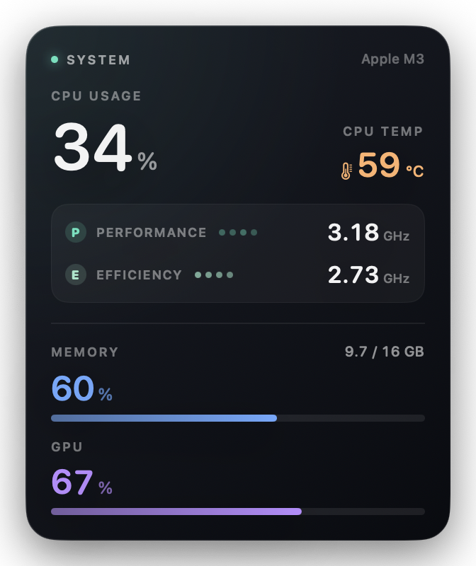

# StatsWidget

macOS masaüstü için tek parça sistem istatistik widget'ı. Apple Silicon Mac'lerde çalışır.



## Gösterilen metrikler

| Metrik | Kaynak |
| --- | --- |
| CPU performance çekirdek frekansı (GHz) | macmon / IOReport |
| CPU efficiency çekirdek frekansı (GHz) | macmon / IOReport |
| CPU sıcaklığı (°C) | macmon / PMU sensörleri |
| CPU kullanımı (%) | `host_processor_info` |
| RAM kullanımı (%) | `host_statistics64` |
| RAM kullanımı (GB / toplam GB) | `host_statistics64` |
| GPU kullanımı (%) | IOAccelerator |

CPU kullanımı Activity Monitor ile aynı mantıkta hesaplanır. RAM tarafında "App Memory + Wired + Compressed" toplamı kullanılır.

> **Not:** Intel Mac'lerdeki "CPU Proximity" sensörü Apple Silicon'da bulunmaz. Bu widget
> CPU sıcaklığı için PMU sensörlerinin ortalamasını gösterir; etiket bu yüzden `CPU TEMP`.

## Çalıştırma

Uygulamayı `/Applications` klasörüne kopyalayıp oradan açabilirsiniz:

```bash
ditto StatsWidget.app /Applications/StatsWidget.app
open /Applications/StatsWidget.app
```

veya Finder'dan `StatsWidget.app` dosyasına çift tıklayın. Uygulama şu anda
`/Applications/StatsWidget.app` içine kopyalanmış durumda.

İlk açılışta Gatekeeper uyarısı görürseniz uygulamaya sağ tıklayıp **Aç** seçin.

Widget varsayılan olarak ekranın sağ üst köşesinde, masaüstü katmanında açılır.
Diğer pencerelerin arkasında kalır; tıpkı macOS'un kendi masaüstü widget'ları gibi
davranır. Dock'ta simgesi yoktur ve menü çubuğunu meşgul etmez.

> macOS'un yerleşik WidgetKit widget'ları sistem istatistiklerine erişemediği için
> canlı veriler bu küçük, bağımsız masaüstü katmanı penceresiyle sağlanır. Ekranda
> ayrı bir "uygulama penceresi" gibi değil, diğer widget'lar gibi görünür ve davranır.

## Kullanım

- **Taşıma:** Widget'ı sol tıkla tutup sürükleyin. Konum otomatik kaydedilir.
- **Sağ tık menüsü:**
  - `Girişte Aç` / `Girişte Açmayı Kapat` — oturum açılışında otomatik başlatma
  - `Çıkış`
- Widget her saniye güncellenir ve diğer pencerelerin arkasında kalır.

## Veri kaynağı ve macmon

Frekans ve sıcaklık bilgisi Apple'ın özel IOReport/PMU sayaçlarından okunur.
Bunun için [macmon](https://github.com/vladkens/macmon) kullanılır ve uygulamanın
içine gömülüdür (`StatsWidget.app/Contents/Resources/macmon`). Yani Homebrew
kurulu olmasa da widget frekans ve sıcaklığı gösterebilir.

macmon bulunamazsa widget yine çalışır; yalnızca frekans ve sıcaklık `—` görünür
ve üstte küçük bir uyarı simgesi çıkar. Bu durumda:

```bash
brew install macmon
```

## Derleme

```bash
./build.sh
```

Gereksinimler: macOS 14+, Xcode Command Line Tools (`swiftc`).
Betik `StatsWidget.app` paketini oluşturur, `macmon` varsa içine kopyalar ve
ad-hoc imzalar.

## Kaldırma

1. Widget'a sağ tıklayıp **Çıkış** deyin.
2. `StatsWidget.app` dosyasını silin.
3. Girişte açmayı kullandıysanız şu dosyayı silin:

```bash
rm ~/Library/LaunchAgents/com.erdinc.statswidget.login.plist
```

4. Kaydedilen konumu temizlemek için:

```bash
defaults delete com.erdinc.statswidget
```

## Dosya yapısı

```
StatsWidget/
├── Sources/StatsWidget.swift   # Uygulama, arayüz ve ölçüm kodu
├── Resources/Info.plist        # Uygulama paketi bilgileri
├── Resources/macmon-LICENSE.txt
├── build.sh
├── preview.png
└── StatsWidget.app             # Derlenmiş uygulama
```

## Lisans

Uygulama kodu bu proje içindir. Gömülü `macmon` bileşeni MIT lisanslıdır,
ayrıntılar `Resources/macmon-LICENSE.txt` dosyasındadır.
